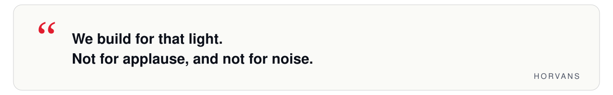

<picture>
  <source media="(prefers-color-scheme: dark)" srcset="assets/banner-dark.svg">
  
</picture>

<i>Every tomorrow is built by someone, today.</i>

<picture>
  <source media="(prefers-color-scheme: dark)" srcset="assets/divider-dark.svg">
  
</picture>

### &nbsp;Why we exist

Somewhere tonight, a student is studying by the light of a phone screen, on a network that keeps dropping, with a dream far bigger than their town.

We build for that light.

Not for applause, and not for noise. For the quiet moment when a door that was closed simply opens, and someone walks through it without ever knowing who held it.

### &nbsp;What we believe

<picture>
  <source media="(prefers-color-scheme: dark)" srcset="assets/beliefs-dark.svg">
  
</picture>

 

<picture>
  <source media="(prefers-color-scheme: dark)" srcset="assets/quote-dark.svg">
  
</picture>

### &nbsp;What we make, for now

Tools that help teachers teach and learners rise, starting with [Horvan Edu Coaching](https://edu.horvans.com).

 

  <a href="https://horvans.com">
    <picture>
      <source media="(prefers-color-scheme: dark)" srcset="assets/mark-dark.svg">
      
    </picture>
  </a>
   
  <a href="https://horvans.com">horvans.com</a> &nbsp;&middot;&nbsp; building the tomorrow we want to wake up in

